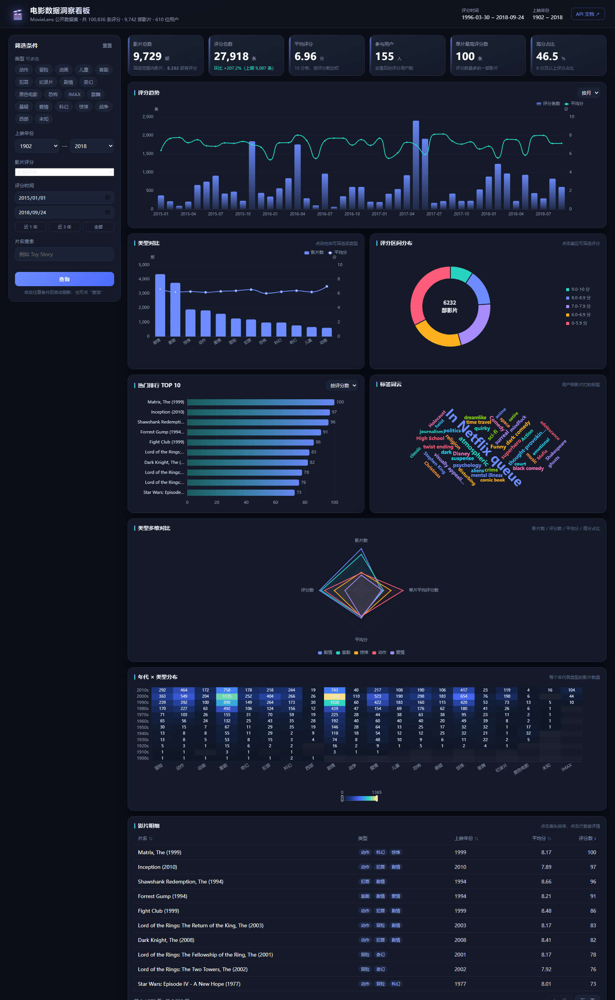

# 电影数据洞察看板（MovieLens）

《Web开发技术》结课项目 —— 基于 MovieLens 公开数据集的电影评分数据看板。

从 10 万条真实评分记录出发，经过 **MySQL 存储 → Spring Boot + MyBatis 聚合 → 原生 HTML/CSS/JS + ECharts 可视化**，
形成一个可筛选、可联动、可下钻的数据看板。



---

## 一、功能一览

| 模块 | 内容 |
| --- | --- |
| KPI 卡片（6 个） | 影片总数、评分总数（含环比）、平均评分、参与用户、单片最高评分数、高分占比 |
| 折线 / 柱状 | 评分趋势（按月 / 按日，评分数 + 平均分双轴） |
| 柱状 + 折线 | 类型对比（影片数 + 平均分） |
| 环形图 | 评分区间分布（5 档） |
| 横向条形 | 热门排行 TOP 10（可按评分数 / 平均分切换） |
| 词云 | 用户标签词频 TOP 45 |
| 雷达图 | 类型多维对比（影片数 / 评分数 / 平均分 / 单片平均评分数） |
| 热力图 | 年代 × 类型 影片数分布 |
| 明细表格 | 分页、按字段排序、点击行弹出影片详情 |
| 筛选联动 | 类型多选、上映年份区间、影片评分区间、评分时间区间、片名搜索 |
| 图表联动 | 点击类型柱 → 筛选该类型；点击评分扇区 → 筛选该评分段；点击 TOP 柱 → 查看详情 |

## 二、技术栈

- 后端：Spring Boot 3.2.5 + MyBatis 3.0.3 + MySQL 8.0，JDK 17
- 前端：原生 HTML + CSS + JavaScript（ES6），ECharts 5.5 + echarts-wordcloud 2.1
- 接口文档：springdoc-openapi（Swagger UI）
- 构建：Maven

> 前端没有使用 Vue/React，直接用 `fetch` 调接口，符合《选题及要求》中“原生 HTML/CSS/JS + ECharts”的约束。

## 三、目录结构

```
movie-dashboard/
├── pom.xml                     Maven 配置
├── README.md
├── src/main/java/com/ctgu/movie/
│   ├── MovieDashboardApplication.java   启动类
│   ├── common/                统一返回 Result、分页、异常、排序白名单
│   ├── config/                跨域、静态资源、Swagger 配置
│   ├── controller/            REST 接口（统计 + 影片）
│   ├── service/               业务逻辑与聚合结果组装
│   ├── mapper/                MyBatis Mapper 接口
│   ├── entity/                数据库实体
│   └── dto/                   接口出入参对象
├── src/main/resources/
│   ├── application.yml        数据源、MyBatis、Swagger 配置
│   ├── application-local.yml.example  数据库账号模板
│   └── mapper/                MyBatis SQL（聚合语句都在这里）
├── web/                       前端页面（由后端直接托管）
│   ├── index.html
│   ├── css/style.css
│   ├── js/api.js              接口封装
│   ├── js/charts.js           ECharts 图表配置
│   ├── js/app.js              页面状态与交互
│   └── lib/                   ECharts 本地依赖（离线可用）
├── sql/                       建表与数据导入脚本
└── doc/                       项目文档、截图、答辩材料
```

## 四、快速开始

### 1. 环境检查

| 软件 | 版本 | 检查命令 |
| --- | --- | --- |
| JDK | 17 | `java -version` |
| Maven | 3.6+ | `mvn -v` |
| MySQL | 8.0 | `mysql --version` |

> 本机已安装 JDK 17 与 MySQL 8.0（`D:\mysql`），可直接用。

### 2. 导入数据库

在项目根目录双击 `sql/import.bat`，或在命令行执行：

```bat
cd /d 项目路径\movie-dashboard\sql
import.bat
```

脚本会按顺序执行 4 个 SQL 文件，最后建出 5 张表：

| 表 | 说明 | 行数 |
| --- | --- | --- |
| dim_movie | 影片维度 | 9,742 |
| dim_genre | 类型维度 | 20 |
| rel_movie_genre | 影片-类型关联 | 22,084 |
| fact_rating | 评分事实表 | 100,836 |
| fact_tag | 标签事实表 | 3,683 |

导入完成后可校验：

```sql
USE movie_dashboard;
SELECT COUNT(*) FROM fact_rating;   -- 应为 100836
```

### 3. 配置数据库账号

```bat
copy src\main\resources\application-local.yml.example src\main\resources\application-local.yml
```

打开 `application-local.yml`，把 `username` / `password` 改成自己的 MySQL 账号。
该文件已在 `.gitignore` 中，不会提交到仓库。

### 4. 启动

在 VS Code 的终端（或 CMD）里执行：

```bat
mvnw.cmd spring-boot:run
```

> 第一次运行会自动下载 Maven 3.9.9（约 9 MB，只下载一次）。
> 如果电脑上已经装了 Maven，也可以用 `mvn spring-boot:run`。

看到 `Started MovieDashboardApplication` 后打开浏览器：

- 看板：<http://localhost:8080>
- Swagger 接口文档：<http://localhost:8080/swagger-ui.html>

### 5. 打包（可选）

```bat
mvnw.cmd clean package -DskipTests
java -jar target/movie-dashboard-1.0.0.jar
```

> 注意：必须在项目根目录启动，因为 `web/` 目录是按相对路径加载的。

## 五、接口清单

| # | 方法 | 路径 | 说明 |
| --- | --- | --- | --- |
| 1 | GET | `/api/meta/filters` | 类型列表、年份范围、日期范围、总记录数 |
| 2 | GET | `/api/stats/overview` | KPI（含环比） |
| 3 | GET | `/api/stats/trend` | 评分趋势，`granularity=day\|month` |
| 4 | GET | `/api/stats/genres` | 类型维度统计 |
| 5 | GET | `/api/stats/rating-distribution` | 评分区间分布 |
| 6 | GET | `/api/stats/top` | TOP N，`metric=ratingCount\|avgScore` |
| 7 | GET | `/api/stats/tags` | 标签词频 |
| 8 | GET | `/api/stats/heatmap` | 年代 × 类型 热力图 |
| 9 | GET | `/api/movies` | 影片分页列表（筛选 + 排序 + 分页） |
| 10 | GET | `/api/movies/{id}` | 影片详情 |

所有接口返回统一结构：

```json
{ "code": 200, "message": "success", "data": {}, "timestamp": 1710000000000 }
```

公共筛选参数：`genres`（可重复）、`yearFrom`、`yearTo`、`ratingFrom`、`ratingTo`、`dateFrom`、`dateTo`、`keyword`。

示例：

```
GET /api/stats/trend?genres=科幻&yearFrom=1990&yearTo=2018&dateFrom=2010-01-01&dateTo=2018-09-24&granularity=month
```

状态码约定：查询成功 200，参数不合法 400，资源不存在 404，服务器异常 500。

## 六、数据说明

- 来源：MovieLens `ml-latest-small`（GroupLens Research，University of Minnesota）
  <https://grouplens.org/datasets/movielens/latest/>
- 规模：100,836 条评分、3,683 条标签、9,742 部影片、610 位用户
- 时间范围：1996-03-30 ~ 2018-09-24
- 处理：5 星制评分 ×2 换算为 10 分制；时间戳按东八区转换为日期；从片名解析上映年份；类型英文名映射为中文
- 详见 `doc/数据说明.md`

## 七、常见问题

| 现象 | 原因与处理 |
| --- | --- |
| 启动报 `Access denied for user` | `application-local.yml` 里的账号密码不对 |
| 页面能开但图表全空 | 数据库没导入，或后端 8080 端口没起来；按 F12 看 Console 报错 |
| `Unknown database 'movie_dashboard'` | 没有执行 `sql/01_schema.sql` |
| 端口被占用 | `application.yml` 里改 `server.port`，或关掉占用 8080 的程序 |
| 中文乱码 | 导入时加 `--default-character-set=utf8mb4`（import.bat 已加） |
| 修改前端没生效 | 按 `Ctrl + F5` 强制刷新 |

## 八、提交物对应关系

| 任务书要求 | 本仓库位置 |
| --- | --- |
| 源码工程 | `src/`、`web/`、`pom.xml` |
| 项目文档 | `doc/项目文档.docx` |
| 演示视频 | 自行录制，放 `video/` |
| AI 使用记录表 | `doc/AI使用记录表.docx` |
| Git 记录 | 本仓库提交历史 |
| 数据库脚本 | `sql/` |
| 演示 PPT | `doc/演示PPT.pptx` |
